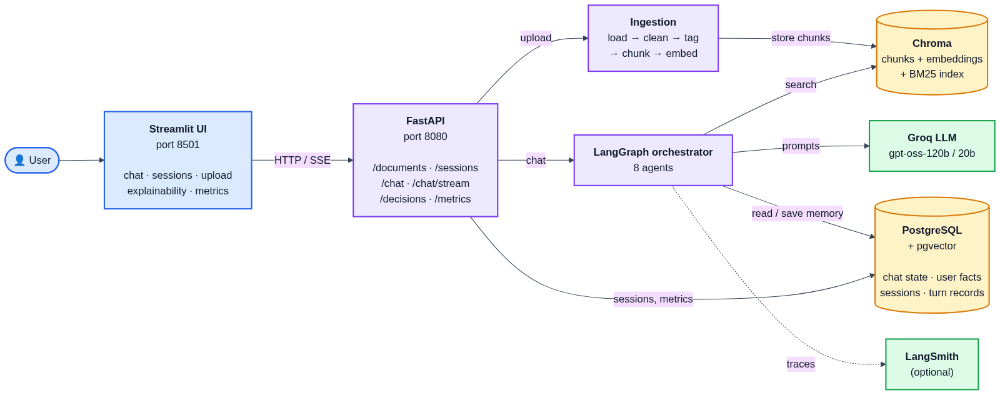
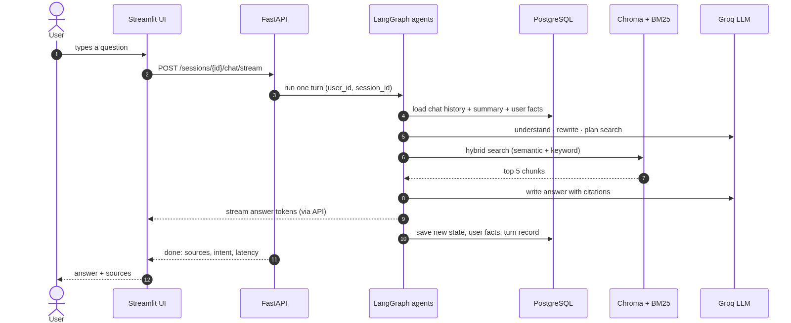
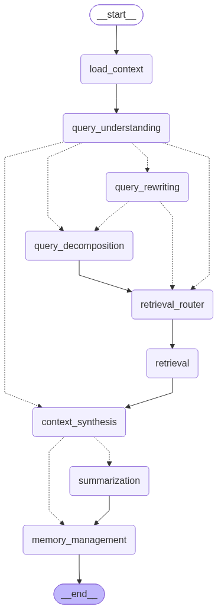
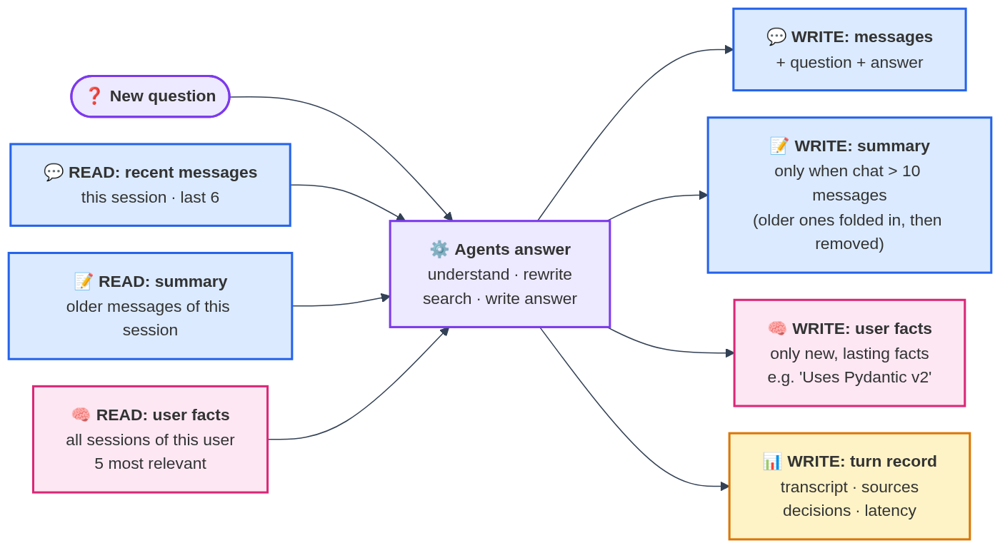

# Conversational RAG with LangGraph

A chat assistant that answers questions from technical documentation. It remembers the
conversation (so follow-ups like *"how do I test **it**?"* work), remembers each user across
sessions, and shows how every answer was produced.

**Stack:** LangGraph + LangChain · Groq (or Claude / OpenAI) · Chroma · PostgreSQL · FastAPI · Streamlit · LangSmith

---

## Quick start (Docker)

```bash
cp .env.example .env
docker compose up -d --build
```

Set `GROQ_API_KEY` in `.env` before starting (optionally `LANGSMITH_API_KEY`).

| What | Where |
|---|---|
| Chat UI (Streamlit) | http://localhost:8501 |
| API docs (Swagger) | http://localhost:8080/docs |

The 9 sample documents are indexed automatically on first start.

---

## `.env` setup

All settings live in `.env` (copy it from `.env.example`). Only the LLM key is required;
everything else has working defaults.

**Required**

| Variable | Value | Where to get it |
|---|---|---|
| `LLM_PROVIDER` | `groq` (or `anthropic` / `openai`) | - |
| `GROQ_API_KEY` | `gsk_...` | https://console.groq.com/keys |

Using Claude or OpenAI instead? Set `LLM_PROVIDER=anthropic` + `ANTHROPIC_API_KEY`, or
`LLM_PROVIDER=openai` + `OPENAI_API_KEY`. Models are picked automatically per provider
(override with `LLM_MODEL` / `LLM_FAST_MODEL`).

**Optional: LangSmith tracing**

| Variable | Value |
|---|---|
| `LANGSMITH_TRACING` | `true` |
| `LANGSMITH_API_KEY` | `lsv2_...` from https://smith.langchain.com (Settings -> API Keys) |
| `LANGSMITH_PROJECT` | `conversational-rag` (any name) |

**Optional: tuning** (defaults are fine)

| Variable | Default | Meaning |
|---|---|---|
| `LLM_MAX_TOKENS` | `2048` | Max answer length (keep >= 2048 for reasoning models like gpt-oss) |
| `HYBRID_ALPHA` | `0.7` | Search weight: 1 = only semantic, 0 = only keyword |
| `CHUNK_SIZE` / `CHUNK_OVERLAP` | `1000` / `150` | Document chunk size in characters |
| `MEMORY_STRATEGY` | `summary_buffer` | or `sliding_window` (drop old messages without summarizing) |
| `SUMMARY_THRESHOLD` / `WINDOW_SIZE` | `10` / `6` | Summarize after 10 messages, keep the last 6 |
| `COMPRESSION_RATIO` | `0.3` | Summary length relative to the text it replaces |

**Tips**
- Write values without quotes or spaces: `GROQ_API_KEY=gsk_abc123`, not `GROQ_API_KEY = "gsk_abc123"`.
- Never commit `.env` (it is in `.gitignore`); `.env.example` must keep keys empty.
- Keep `CHROMA_HOST=localhost` and the `localhost` `POSTGRES_URL` - Docker Compose replaces them
  with the container names automatically.
- After editing `.env`, restart so it is picked up: `docker compose up -d` (or restart `uvicorn`).
- Check it worked: http://localhost:8080/health shows `postgres`, `chroma` and `langsmith_tracing`.

---

## Running with Docker

**Prerequisites:** Docker Desktop (or Docker Engine with Compose v2), ~4 GB free disk, and a Groq API key.

**1. Configure** - create `.env`, then set `LLM_PROVIDER=groq` and `GROQ_API_KEY=gsk_...` in it.
```bash
cp .env.example .env
```

**2. Build and start**
```bash
docker compose up -d --build
```
The first build downloads Python packages and the embedding model, so it takes a few minutes; later starts take seconds.

**3. Check it is running** - `api`, `chroma`, `postgres` and `ui` should show *healthy*, `seed` *Exited (0)*,
and `/health` should return `"status":"ok"`.
```bash
docker compose ps
curl http://localhost:8080/health
```
Then open the UI at http://localhost:8501 (API docs: http://localhost:8080/docs).

**What starts**

| Service | Port | What it does |
|---|---|---|
| `chroma` | 8000 | Vector database for document chunks |
| `postgres` | 5432 | Chat memory, user facts, sessions, metrics |
| `seed` | - | Indexes the 9 sample docs on first start, then exits |
| `api` | 8080 | FastAPI + LangGraph agents |
| `ui` | 8501 | Streamlit app |
| `pgadmin` (optional) | 5050 | Database GUI: `docker compose --profile tools up -d pgadmin` |

Data is kept in Docker volumes (`chroma_data`, `postgres_data`, `uploads`), so it survives restarts.

**Everyday commands**

| Task | Command |
|---|---|
| Follow API logs | `docker compose logs -f api` |
| Restart after editing `.env` | `docker compose up -d` |
| Rebuild after changing code | `docker compose up -d --build api ui` |
| Stop everything (keep data) | `docker compose down` |
| Stop and delete all data | `docker compose down -v` |
| Re-index the sample docs (also removes uploaded docs from search) | `docker compose run --rm seed python -m scripts.seed_docs --reset` |

**Troubleshooting**
- *Port already in use (8080 / 8501 / 5432 / 8000):* stop the local process using it, or stop
  local `uvicorn` / `streamlit` runs before starting the containers.
- *`api` not healthy:* `docker compose logs api` - usually a missing `GROQ_API_KEY` or the database still starting.
- *Answers fail but health is ok:* check the LLM key and that `LLM_PROVIDER` matches it.

---

## System architecture



- **Streamlit UI** talks only to the **FastAPI** service (HTTP, and SSE for streaming answers).
- **Uploads** go through the ingestion pipeline into **Chroma** (vectors) + a **BM25** keyword index.
- **Chat** runs the **LangGraph orchestrator**: it searches Chroma, calls the **Groq LLM**, and reads/saves
  memory in **PostgreSQL**. **LangSmith** optionally records a trace of every step.
- Everything runs in Docker Compose: `chroma`, `postgres`, `api`, `ui` (+ a one-shot `seed` job for the sample docs).

### Asking a question (step by step)



### Adding a document


More detail on every diagram: [docs/architecture.md](docs/architecture.md). Mermaid sources: `docs/diagrams/`.

---

## LangGraph agent flow

Every message goes through this graph (generated from the code):



| Agent | What it does |
|---|---|
| **Query Understanding** | Detects the intent: new question, follow-up, multi-part, chitchat or out of scope |
| **Query Rewriting** | Turns a follow-up into a standalone question using the chat history |
| **Query Decomposition** | Splits a multi-part question into separate searches |
| **Retrieval Router** | Picks the search type (hybrid / semantic / keyword) and filters (product, version, has code) |
| **Retrieval** | Hybrid search: Chroma embeddings + BM25 keywords, merged with rank fusion |
| **Context Synthesis** | Writes the answer from the retrieved docs, with citations like [1] |
| **Summarization** | Summarizes older messages when a chat gets long |
| **Memory Management** | Saves lasting facts about the user (e.g. "Uses Pydantic v2") |

The **orchestrator** is the LangGraph graph itself (`app/graph/graph.py`): it runs the agents in
order and routes between them (e.g. chitchat skips retrieval; follow-ups go through rewriting).

---

## Memory



Blue = this session only · Pink = shared by all sessions of the same user · Yellow = app records.
All of it is stored in PostgreSQL (`checkpoints*`, `store*`, `chat_sessions` / `turn_records` tables).

| Memory | Scope | Stored in | Example |
|---|---|---|---|
| Conversation | one session | PostgreSQL (LangGraph checkpointer) | the messages of this chat |
| Summary | one session | PostgreSQL (in the same state) | "User asked about Kubernetes rollbacks…" |
| User facts | all sessions of a user | PostgreSQL + pgvector (LangGraph store) | "New to Kubernetes", "Deploys on AWS EKS" |

- Chats longer than **10 messages** keep the last **6** and fold the rest into a summary (~30% of the original length).
- Sessions are isolated per user (`X-User-Id` header); user facts are shared only between that user's sessions.

---

## Documents

- Formats: **PDF, Markdown, HTML** (sample docs: FastAPI, Pydantic, Docker Compose, Kubernetes, Redis, PostgreSQL, Python 3.12, LangGraph - see `data/SOURCES.md`).
- Each file is cleaned, split by headings (code blocks kept whole) and tagged with metadata:
  document type, product, version, section, and whether it contains code.
- Upload more from the UI sidebar or `POST /documents/upload`.

---

## API examples

```bash
# 1. Start a session
curl -X POST localhost:8080/sessions -H "X-User-Id: alice"
# -> {"session_id": "9ee5aa6b...", ...}

# 2. Ask questions (the second one is a follow-up)
curl -X POST localhost:8080/sessions/<session_id>/chat -H "X-User-Id: alice" \
     -H "Content-Type: application/json" -d '{"message": "How do I roll back a Kubernetes deployment?"}'
curl -X POST localhost:8080/sessions/<session_id>/chat -H "X-User-Id: alice" \
     -H "Content-Type: application/json" -d '{"message": "How do I see its revision history?"}'

# 3. Upload a document
curl -X POST localhost:8080/documents/upload -F "file=@my_guide.md"
```

| Endpoint | Purpose |
|---|---|
| `POST /documents/upload` · `GET /documents` | Add / list documents |
| `POST /sessions` · `GET /sessions` | Start / list sessions |
| `POST /sessions/{id}/chat` · `/chat/stream` | Ask a question (normal or streamed) |
| `GET /sessions/{id}/transcript` · `/history` | Full chat / what the model currently sees |
| `GET /sessions/{id}/decisions` | What each agent decided and why |
| `GET /memories` | What the assistant remembers about you |
| `GET /metrics` · `GET /health` | Performance numbers / service status |

---

## Sample conversation

> **You:** How do I roll back a Kubernetes deployment?
> **Assistant:** Use `kubectl rollout undo deployment/<name>` … [1]
>
> **You:** How do I see its revision history?
> *(rewritten to: "How do I see the revision history of a Kubernetes deployment?")*
> **Assistant:** `kubectl rollout history deployment/<name>` … [1]

> **You:** How do I convert a dict into a model, and how do I run my app with Redis using Docker Compose?
> *(split into two searches: Pydantic + Docker Compose; answer cites both docs)*

> **You:** What's the capital of France?
> **Assistant:** That's outside what I can help with - I answer questions about FastAPI, Pydantic, Docker, …

---

## Benchmarks

Measured on this project's sample docs (Groq `gpt-oss-120b` / `gpt-oss-20b`, local embeddings).

**Retrieval** - 32 labelled questions (`python -m scripts.eval_retrieval`), hit@5 / MRR:

| Search | Exact wording | Paraphrased | All |
|---|---|---|---|
| Semantic only | 1.00 / 0.94 | 0.93 / 0.74 | 0.97 / 0.85 |
| Keyword (BM25) only | 1.00 / 1.00 | 0.64 / 0.60 | 0.84 / 0.82 |
| **Hybrid (default)** | 1.00 / 0.97 | 0.93 / 0.75 | **0.97 / 0.87** |
| Hybrid + reranker | 1.00 / 0.97 | 0.86 / 0.70 | 0.94 / 0.85 |

Hybrid search was the best overall; the cross-encoder reranker didn't help here, so it is off by default.

**Latency & memory** (live API runs):

| Metric | Value |
|---|---|
| Full answer | ~3.3 - 4.7 s per turn |
| First streamed token | ~3 s |
| Retrieval step | ~40 - 100 ms |
| Conversation state in PostgreSQL | ~155 KB per session after 2-3 turns (~9 checkpoints per turn) |

Live numbers for your own runs: `GET /metrics` or the **Metrics** page in the UI.

---

## Observability

- **Explainability page** (Streamlit): per turn - intent, rewritten query, search strategy, retrieved
  chunks, and each agent's decision and latency.
- **LangSmith** (optional): set `LANGSMITH_TRACING=true` and `LANGSMITH_API_KEY` in `.env` to trace every
  agent step and LLM call. Each turn's `trace_id` is shown in the UI and API.

---

## Run without Docker (development)

```bash
docker compose up -d chroma postgres
uv venv --python 3.11 && source .venv/bin/activate
uv pip install -r requirements.txt
python -m scripts.seed_docs
uvicorn app.main:app --port 8080
streamlit run ui/streamlit_app.py
python -m scripts.chat
python -m pytest
```

---

## Project structure

```
app/
  api/          FastAPI routes and schemas
  graph/        LangGraph state, graph (orchestrator), prompts, agents in nodes/
  ingestion/    load, clean, chunk, tag documents
  memory/       Chroma, BM25, PostgreSQL checkpointer + user memory store
  observability/ decision log, LangSmith setup
ui/             Streamlit app (chat, explainability, metrics pages)
scripts/        seed docs, search, retrieval benchmark, terminal chat
data/           sample docs, eval questions
tests/          unit + API tests
```

Main settings are in `.env` (see `.env.example`): LLM provider, chunk size, hybrid weight,
memory strategy (`summary_buffer` or `sliding_window`), summary threshold and compression ratio.
