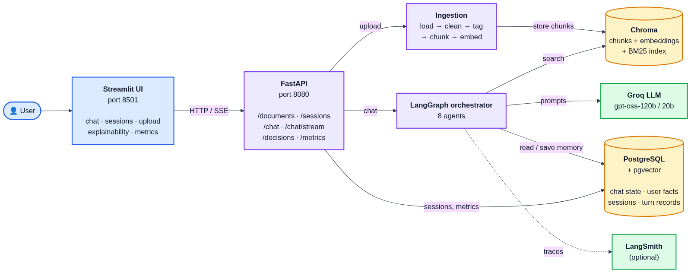
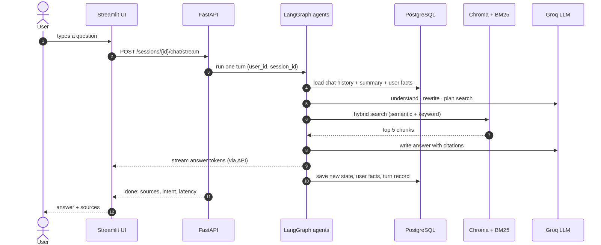
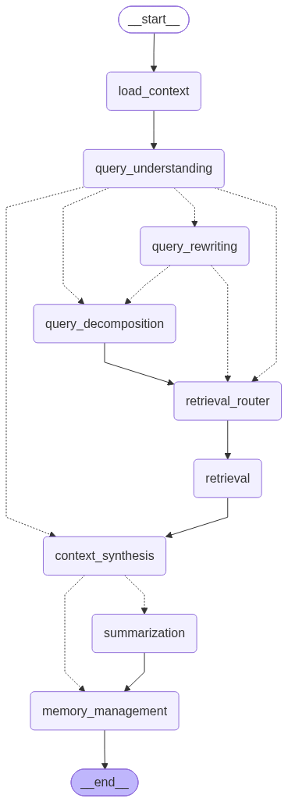
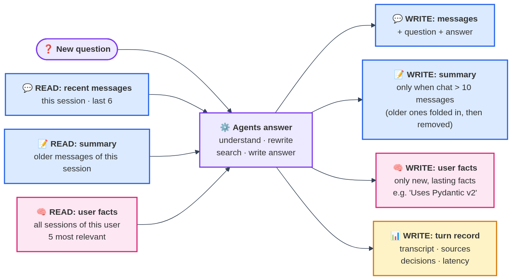

# System Architecture

A short visual guide to how the Conversational RAG system is put together.
Diagram sources (Mermaid) are in [`diagrams/`](diagrams/).

---

## 1. Components

| Component | Role |
|---|---|
| **Streamlit UI** (port 8501) | Chat, session list, document upload, explainability and metrics pages. Talks only to the API. |
| **FastAPI** (port 8080) | REST + streaming (SSE) endpoints; checks which user owns which session. |
| **Ingestion** | Turns uploaded PDF / Markdown / HTML into tagged, searchable chunks. |
| **LangGraph orchestrator** | Runs the 8 agents for every message and decides the route between them. |
| **Chroma + BM25** | Document search: meaning-based (embeddings) and keyword-based, merged. |
| **PostgreSQL + pgvector** | All memory: chat state, user facts, sessions, per-turn records. |
| **Groq LLM** | `gpt-oss-120b` writes answers; `gpt-oss-20b` runs the smaller agent decisions. |
| **LangSmith** (optional) | Records a trace of every agent step and LLM call. |

Everything runs with `docker compose up`: `chroma`, `postgres`, `api`, `ui`, plus a one-shot `seed`
job that indexes the sample documents on first start.

---

## 2. Asking a question

1. The UI sends the message to `/sessions/{id}/chat/stream`.
2. LangGraph loads the session's recent messages, its summary and the user's relevant facts from PostgreSQL.
3. Small LLM calls decide the intent, rewrite follow-ups ("how do I test **it**?") and plan the search.
4. Hybrid search returns the top 5 chunks from Chroma + BM25.
5. The main LLM writes the answer with citations like `[1]`; tokens stream back to the UI as they are generated.
6. The new state, any new user facts and a turn record are saved to PostgreSQL.

---

## 3. LangGraph agent flow

| Agent | What it does |
|---|---|
| `load_context` | Starts the turn: resets per-turn data, loads relevant user facts |
| `query_understanding` | Intent: new question, follow-up, multi-part, chitchat or out of scope |
| `query_rewriting` | Makes a follow-up a standalone question (only for follow-ups) |
| `query_decomposition` | Splits a multi-part question into sub-questions (only for multi-part) |
| `retrieval_router` | Chooses the search type and filters (document, product, version, code) |
| `retrieval` | Runs the hybrid search |
| `context_synthesis` | Writes the cited answer (chitchat / out of scope skip straight here) |
| `summarization` | Folds old messages into a summary once a chat passes 10 messages |
| `memory_management` | Saves lasting facts about the user |

Solid arrows always run; dotted arrows are routing decisions.

---

## 4. Adding a document

- **Load & clean:** extracts the main text (drops menus and site-specific syntax); PDFs keep code indentation.
- **Tag metadata:** document type, product, version, section headings, whether a chunk has code.
- **Chunk:** split by headings into ~1000-character chunks; code blocks are never cut in half.
- **Embed & store:** MiniLM embeddings (runs locally) into Chroma; the BM25 index is rebuilt, so the
  document can be questioned immediately.

---

## 5. Memory

| Memory | Scope | Where (PostgreSQL) |
|---|---|---|
| Recent messages | This session | `checkpoints`, `checkpoint_blobs` (LangGraph checkpointer) |
| Summary of older messages | This session | same checkpointed state |
| User facts, e.g. "Uses Pydantic v2" | All sessions of the same user | `store`, `store_vectors` (LangGraph store + pgvector) |
| Turn record: transcript, sources, decisions, latency | Per turn | `turn_records` (app table) |

- A session only ever sees its own messages; a user's facts are shared by all of that user's sessions.
- Once a chat passes 10 messages, the last 6 are kept and older ones are folded into the summary
  (~30% of their length), so prompts stay small.
- The checkpointer saves a snapshot after every agent step, so a session can always resume where it left off.
